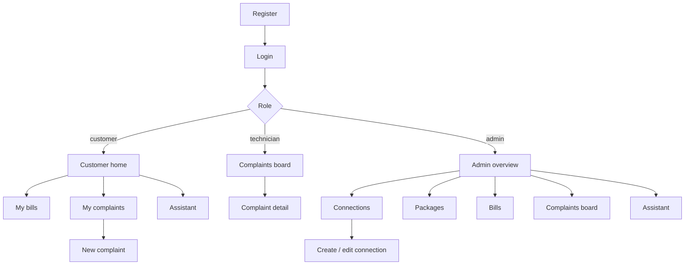
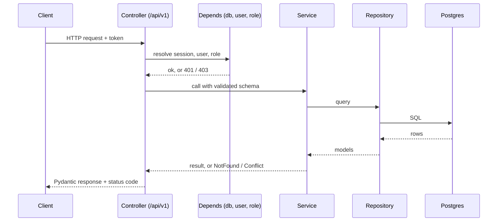
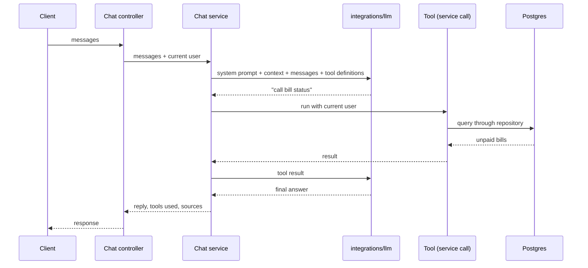

# App Flow — NetDesk

How people move through the app, and how a request moves through the system.

## 1. Screen map

## 2. User flows

### 2.1 Register and log in
1. Visitor opens the app and lands on Login.
2. New visitor chooses Register, enters name, email, phone and password.
3. Success → back to Login with a "registered" message. Duplicate email → message beside the email field.
4. Login with email and password → token stored → profile fetched → sent to the home for their role.
5. Wrong details → one generic message, the same for a wrong email or a wrong password.

### 2.2 Customer checks a bill
1. Customer home shows package, status and total due.
2. Opens My bills → list by month with paid or unpaid.
3. No connection yet → an empty state explaining the operator has not linked one.

### 2.3 Customer reports a problem
1. My complaints → New complaint.
2. Chooses a category, writes a description, submits.
3. The complaint appears as "open". Later it shows "assigned", then "resolved".

### 2.4 Customer asks the assistant
1. Opens Assistant; sees three suggested questions.
2. Sends a message; a waiting indicator shows.
3. The reply appears with badges for tools used and a list of sources.
4. Follow-up questions keep the earlier context.
5. "New chat" clears the conversation.

### 2.5 Technician works a complaint
1. Lands on the Complaints board, filters by area and status.
2. Opens a complaint, assigns it to self.
3. After the visit, marks it resolved.

### 2.6 Admin manages connections
1. Connections → filter by area or status, or search by name, phone or code.
2. Create: picks a customer and a package, enters code, area, address and date.
3. Duplicate code → conflict message beside the field; nothing is lost from the form.
4. Edit or delete from the row. Delete asks for confirmation; a connection with bills is disconnected instead.

### 2.7 Admin handles billing
1. Bills → filter to unpaid.
2. Generates this month's bills for all active connections (already billed ones are skipped).
3. Marks a bill paid, choosing the method and entering the transaction ID.

### 2.8 Admin posts an outage
1. Complaints board shows a cluster in one area.
2. Posts an area notice with an expected fix time.
3. Customers in that area who ask the assistant are told about it.

### 2.9 Session ends
- Logout clears the token and the chat.
- An expired token on any call sends the user to Login with a "session expired" message.
- Opening a page for another role redirects to the user's own home.

## 3. System flows

These are the five flows to explain in the video, pointing at real files.

### 3.1 API request

### 3.2 Chat with tools

### 3.3 RAG
**Ingest (once, and after documents change):** read files → split into overlapping chunks → embed each chunk → store text and vector.

**Question (every chat turn):** embed the question → fetch nearest chunks → drop those beyond the distance limit → if any remain, add them to the prompt with sources; if none, tell the model nothing matched → the model answers from the chunks or says it found nothing.

### 3.4 MCP
Client → `/mcp` (HTTP) or stdio → tool, resource or prompt → the same service used by the API → repository → database → result back to the client.

### 3.5 Auth
- **Register:** validate → hash password → store user as customer.
- **Login:** find user → verify hash → issue token with user id and expiry. Any failure → the same 401.
- **Each request:** read token → verify signature and expiry → load user → read role from the database → allow or 403.

## 4. Error paths the user can see

| Situation | What happens |
|---|---|
| Not logged in or token expired | Sent to Login |
| Wrong role for a page or action | Redirected, or a "no permission" message |
| Record not found | In-place "not found" state |
| Duplicate value | Message beside the field |
| Invalid input | Messages under the fields |
| Server or network failure | "Something went wrong" with Retry |
| Assistant service down | A message in the chat; the typed text is kept |
