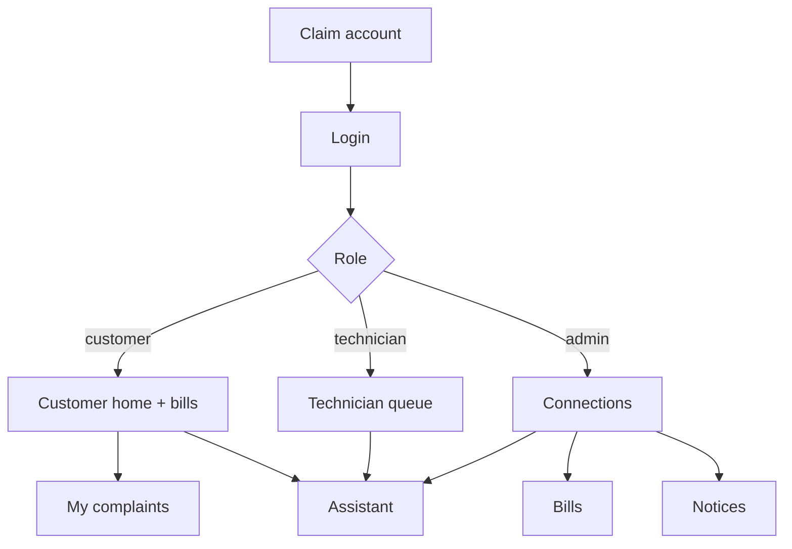

# App Flow — NetDesk

How people move through the app, and how a request moves through the system. Source of truth: `PROPOSAL.md` (§6.6–6.10 flows, §8 API, §11 pages).

## 1. Screen map (the 9 P0 pages)

Packages, users, knowledge and the dashboard are P1; Swagger covers them meanwhile (§5, Refined plan).

## 2. User flows

### 2.1 Claim and log in
1. A new customer opens Claim account and enters customer code, phone, email and password.
2. Code and phone match an unclaimed connection → 201, back to Login. No match → 404 "no matching connection". Email taken or connection already claimed → 409.
3. Login with email and password → token stored → `/auth/me` → home for the role.
4. Wrong email or wrong password → one identical 401 message. Too many tries → 429.
5. An inactive user gets 401 on the next call.

### 2.2 Customer checks a bill
1. Customer home shows the current bill, due date, status and any outage banner for the area.
2. Past months are listed on the same page. No bills yet → empty state "No bills yet".

### 2.3 Customer reports a problem
1. My complaints → New complaint: category and description (max 1,000 characters).
2. It shows as open, then in progress, then resolved or closed.
3. If `ALLOW_CUSTOMER_COMPLAINTS=false`, creation returns 403 and the page shows a no-permission message (§11.2).

### 2.4 Chat (stored session)
1. Opens Assistant → session list; "New chat" creates a session (`POST /chat/sessions`).
2. Sends a message; a "Thinking…" row shows. The reply arrives with tool chips and source chips.
3. Follow-up questions use the stored history. Old sessions can be reopened.
4. Daily limit reached → 429 message. Provider down or chat switched off → 503, "assistant offline", typed text kept.

### 2.5 Technician works a complaint
1. Lands on the queue, filters by area and status.
2. Assigns a complaint, then updates its status. An invalid status change → 409 message.

### 2.6 Admin manages connections
1. Connections → filter by area, status or package; search; pages.
2. Create or edit in a drawer. Duplicate code → 409 beside the field; the form keeps its values.
3. Delete asks for confirmation. A connection with bills → 409 "set Disconnected instead".

### 2.7 Admin handles billing and payments
1. Bills → filter to unpaid.
2. Generate a month: shows created and skipped counts; running it twice creates nothing new.
3. Verify a payment: enters the method and the bKash TrxID. A TrxID already used on another bill → 409. An already-paid bill → 409.

### 2.8 Admin posts an outage
1. Notices → post a notice for an area with start and end time.
2. Customers in that area who open Home or ask the assistant see it (`get_my_area_status`).

### 2.9 Session ends
- Logout clears the token. Chat sessions stay in the database; they are not deleted.
- An expired token (30 minutes, no refresh) sends the user to Login with "session expired".
- A page for another role shows "No access" (403).

## 3. System flows (the five flows for the video)

### 3.1 API request (§6.6)
Client + Bearer token → controller → `Depends` chain (`get_db`, `get_current_user`, `require_roles`) → service → repository → Postgres. Expected failures are raised as `AppError` in the service; global handlers return the envelope. The service commits before the 201 is sent.

### 3.2 Chat with tools (§6.7, §9.4)
1. `POST /chat/sessions/{id}/messages` with `content` (1–1,000 characters).
2. ChatService checks that the user owns the session (else 404), the daily quota (else 429) and `CHAT_ENABLED` (else 503), then saves the user message.
3. It loads the last 12 messages.
4. KnowledgeService retrieves evidence for this role, or returns NO_EVIDENCE (flow 3.3).
5. The LLM gets prompt v1, history, evidence and the tool set for the role.
6. On a tool call, the registry re-checks the role, validates arguments, and calls a service with the user from the JWT. The result goes back to the model. At most 3 rounds, then a fallback reply.
7. The server keeps only `[S#]` citations that were in the evidence.
8. The reply is saved with `tools_used`, `sources`, token counts, model, prompt version and latency, and returned as 201.
9. Provider down after retries → 503.

### 3.3 RAG (§6.8, §9.6)
**Ingest (script, after documents change):** validate front matter → skip if SHA-256 is unchanged → chunk by heading (about 350 tokens, 15% overlap) → embed each chunk with `passage: ` → replace document and chunks in one transaction.

**Retrieve (every chat turn):** embed the message with `query: ` → cosine search over active documents the role may see (customer: public; staff: public and staff), top 4 → keep chunks under the distance limit from config → any left: EVIDENCE S1–S4; none: NO_EVIDENCE → the model answers with citations, or says it has no information. If the embedder is down: NO_EVIDENCE with reason `knowledge_unavailable`; tools still work (§12.3).

### 3.4 MCP (§6.9, §9.7)
- **HTTP:** client → `/mcp` with a Bearer JWT → middleware verifies it, loads the user, requires technician or admin (401, 403) → tool, resource or prompt → the same service as REST → database → result. A host not in `MCP_ALLOWED_HOSTS` gets 421.
- **stdio:** the `netdesk-mcp` script resolves `MCP_STDIO_USER_EMAIL` to an active staff user at startup, or exits. It acts as that user and logs to stderr only.

### 3.5 Auth (§6.10, §10.2)
- **Claim:** validate → find an unclaimed connection by code and phone → 404 / 409 / insert user as customer with an Argon2id hash and link the connection → 201.
- **Login:** find user by email. An unknown email still runs a dummy hash check. Unknown email or wrong password → the same 401 body. Success → token with `sub` only, 30 minutes.
- **Each request:** verify signature and expiry → load user, role and `is_active` from the database → 401 if inactive → allow, or 403 for role, 404 for scope.

## 4. Error paths the user can see

All errors use one envelope: `{"error": {"code", "message", "details", "request_id"}}`. The UI maps `code` to friendly text and shows `request_id` under "Details" (§8.3, §11.3).

| Status | What happens |
|---|---|
| 401 | Sent to Login; failed login shows one generic message |
| 403 | "No permission" or "No access" page |
| 404 | In-place "not found" (also for another user's record) |
| 409 | Message beside the field or in the dialog (duplicate code, reused TrxID, bills exist, invalid status change, claimed connection) |
| 422 | Messages under the fields; submitted values are never echoed |
| 429 | "Too many attempts" or "daily limit reached"; `Retry-After` is sent |
| 500 | "Something went wrong" with Retry and the `request_id` |
| 503 | Assistant offline message in the chat; typed text is kept |
| 421 | MCP clients only: host not in `MCP_ALLOWED_HOSTS` |
