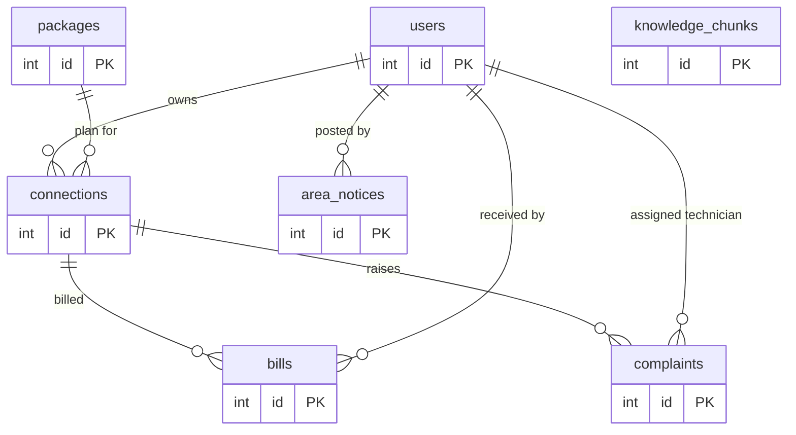

# Schema — NetDesk

Database design. This describes tables, not code; models and migrations are written by hand from it.

Rows marked **(depth)** belong to the "should have" features in `PRD.md` and can be added in a later migration.

## 1. Diagram

## 2. Enumerations

| Name | Values |
|---|---|
| user_role | admin, technician, customer |
| connection_status | active, suspended, disconnected |
| bill_status | unpaid, paid |
| payment_method | bkash, nagad, cash |
| complaint_category | no_internet, slow_speed, router, billing, other |
| complaint_status | open, assigned, resolved |

## 3. Tables

Every table has `id` (integer, primary key) and `created_at` (timestamp with time zone, default now).

### users
| Column | Type | Null | Notes |
|---|---|---|---|
| full_name | text | no | |
| email | text | no | unique, stored lowercase |
| phone | text | no | unique |
| password_hash | text | no | argon2 hash; never returned by the API |
| role | user_role | no | default customer |
| is_active | boolean | no | default true |

### packages
| Column | Type | Null | Notes |
|---|---|---|---|
| name | text | no | unique, e.g. "Home 20 Mbps" |
| speed_mbps | integer | no | greater than 0 |
| monthly_price | numeric(10,2) | no | greater than 0 |
| is_active | boolean | no | default true |

### connections
| Column | Type | Null | Notes |
|---|---|---|---|
| customer_code | text | no | unique, e.g. `MIR-0042` |
| customer_id | integer | no | FK users; must be a customer |
| package_id | integer | no | FK packages; delete restricted |
| area | text | no | indexed, e.g. "Mirpur 10" |
| address | text | no | |
| status | connection_status | no | default active; indexed |
| connected_on | date | no | |

One customer has one connection in this version (unique on `customer_id`). Drop that rule later to allow several.

### bills
| Column | Type | Null | Notes |
|---|---|---|---|
| connection_id | integer | no | FK connections; delete restricted |
| billing_month | date | no | always the first day of the month |
| amount | numeric(10,2) | no | copied from the package price at creation |
| status | bill_status | no | default unpaid; indexed |
| paid_at | timestamp with time zone | yes | set when paid |
| method | payment_method | yes | set when paid |
| transaction_id | text | yes | **(depth)** |
| received_by | integer | yes | FK users **(depth)** |

Unique on (`connection_id`, `billing_month`).

### complaints
| Column | Type | Null | Notes |
|---|---|---|---|
| connection_id | integer | no | FK connections |
| category | complaint_category | no | |
| description | text | no | |
| status | complaint_status | no | default open; indexed |
| technician_id | integer | yes | FK users; must be a technician |
| assigned_at | timestamp with time zone | yes | **(depth)** |
| resolved_at | timestamp with time zone | yes | |

### area_notices **(depth)**
| Column | Type | Null | Notes |
|---|---|---|---|
| area | text | no | indexed |
| message | text | no | e.g. "Fibre cut near Block C" |
| expected_fix_at | timestamp with time zone | yes | |
| is_active | boolean | no | default true |
| posted_by | integer | no | FK users |

### knowledge_chunks
| Column | Type | Null | Notes |
|---|---|---|---|
| source | text | no | file name |
| chunk_index | integer | no | position within the file |
| content | text | no | |
| embedding | vector(N) | no | N is the embedding model's output size |

Unique on (`source`, `chunk_index`). A vector index using cosine distance.

## 4. Integrity rules

| Rule | Enforced by |
|---|---|
| Email, phone, package name, customer code are unique | Database constraints → 409 |
| One bill per connection per month | Database constraint → 409 |
| A package in use cannot be deleted | Foreign key restriction → 409 |
| A connection with bills cannot be deleted | Foreign key restriction → 409; service offers disconnect instead |
| Bill amount is fixed at creation | Service copies the price; later price changes do not rewrite old bills |
| A paid bill has `paid_at` and `method`; an unpaid bill has neither | Service, plus a check constraint |
| A resolved complaint has `resolved_at` | Service |
| Only customers own connections; only technicians are assigned | Service |

## 5. Indexes

- Foreign keys: `connections.customer_id`, `connections.package_id`, `bills.connection_id`, `complaints.connection_id`, `complaints.technician_id`
- Filters: `connections.area`, `connections.status`, `bills.status`, `complaints.status`, `area_notices.area`
- Vector index on `knowledge_chunks.embedding`

## 6. Migration order

1. Enable the vector extension; create `users`
2. `packages`
3. `connections`
4. `bills`
5. `complaints`
6. `knowledge_chunks`
7. **(depth)** payment trail columns, `assigned_at`, `area_notices`

Each step is its own Alembic revision and its own commit.

## 7. Seed data

| Table | Amount | Notes |
|---|---|---|
| users | 1 admin, 2 technicians, about 30 customers | Bangladeshi names; admin credentials from settings |
| packages | 5 | From 10 Mbps to 100 Mbps with realistic prices |
| connections | about 30 | Spread over Mirpur 10, Mirpur 11, Uttara Sector 7, Mohammadpur; a few suspended |
| bills | 3 months per connection | Most paid, some unpaid, a few customers with two unpaid months |
| complaints | about 15 | Mixed statuses; a cluster of open ones in one area for the outage demo |
| area_notices | 1 active | Matches the complaint cluster |

The seed script is safe to run twice: it skips rows that already exist.
