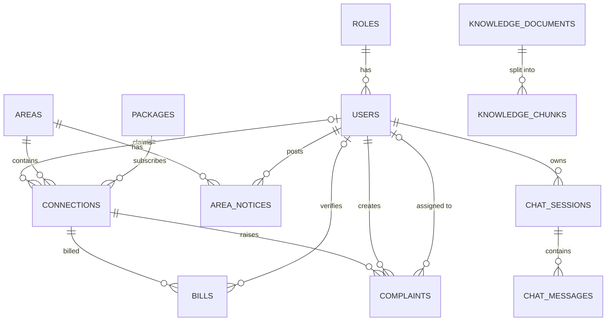

# Schema — NetDesk

Database design. **Source of truth: `PROPOSAL.md` §7.** This file summarises it and points to the section; migrations are autogenerated, then read and fixed by hand (§7.4). Build order is in `BUILD_PLAN.md` (Phase 2, 4, 5).

Twelve tables. Money is `numeric(10,2)` taka, in columns ending `_bdt`. Times are `timestamptz` in UTC, shown in Asia/Dhaka.

## 1. Diagram

Relations only; columns are in section 3 (full diagram: §7.1).

## 2. Id types

`int` primary keys for the lookup tables `roles`, `areas` and `packages`. `uuid` for every other table (§7.2 "Id types"). Roles are a table, not an enum.

## 3. Tables

Constraints come from §7.2. Where the proposal does not list a column or an enum value, it is decided in the migration and the proposal is updated if it matters.

| Table | Main columns and constraints | Indexes |
|---|---|---|
| roles | `name` unique: admin, technician, customer | PK |
| users | `email` unique, stored lower-case; `role_id` FK; `is_active`; Argon2id `password_hash` (never in an API read schema) | unique(email) |
| areas | `code` unique; `name`; `name_bn` | unique(code) |
| packages | `name` unique; `speed_mbps > 0`; `monthly_price_bdt >= 0`; `is_active` | unique(name) |
| connections | The main domain resource. `customer_code` unique, format `ND-\d{6}` (§8.2); `customer_name`; `phone` as E.164; `address`; `status` active / suspended / disconnected; `area_id` FK and `package_id` FK, both RESTRICT; `customer_user_id` FK, nullable until the customer claims the connection | unique(customer_code); (area_id, status); (package_id); (phone) |
| bills | `connection_id` FK; `period` as a month string (`YYYY-MM`); `amount_bdt >= 0`; `due_date`, the 10th of the month after `period`; `status` unpaid / paid / waived | unique(connection_id, period); (status, period); (connection_id) |
| complaints | `connection_id` FK; creator (users FK); `category` enum; `status` open / in_progress / resolved / closed; `description` at most 1,000 chars; `assigned_to` FK, nullable | (status, created_at); (connection_id) |
| area_notices | `area_id` FK; `kind` enum; `message_bn`; `message_en`; `starts_at`; `ends_at`; posted by (users FK); CHECK `ends_at > starts_at` | (area_id, starts_at) |
| knowledge_documents | `slug` unique; `language` bn / en; `visibility` public / staff; `status` active / archived; `content_sha256`; `embedding_model` | unique(slug) |
| knowledge_chunks | `document_id` FK, ON DELETE CASCADE; `chunk_index`; `content`; `embedding vector(384) NOT NULL`; unique(document_id, chunk_index) | (document_id). No vector index in P0 |
| chat_sessions | `user_id` FK; `title`; `deleted_at` nullable (soft delete) | (user_id, updated_at) |
| chat_messages | `session_id` FK; `role` user / assistant; `content` at most 4,000 chars; `tools_used` and `sources` as jsonb; `prompt_version`; `model`; token counts; `latency_ms` | (session_id, created_at) |

### Payment trail (P0)

Added to `bills` in migration `0002_payment_trail`:

- `payment_method`.
- `trx_id`: partial unique index, so a TrxID can be used once (409 on reuse).
- `verified_by`: FK to users, the admin who verified the payment.
- `paid_at` with CHECK: status `paid` if and only if `paid_at` is set.

### Vector rules (§7.2)

Every chunk holds a normalized 384-dimension vector from `multilingual-e5-small`. Each document records `embedding_model`. Retrieval refuses to run if the configured model differs, so vectors from two models are never mixed. Search is an exact cosine scan; HNSW is P1 (§5, §6.5).

## 4. Integrity rules

| Rule | Enforced by |
|---|---|
| Unique: role name, email, area code, package name, customer code, document slug | Database constraint → 409 |
| One bill per connection per period | Unique(connection_id, period) → 409 |
| A TrxID is used once | Partial unique index → 409 |
| Paid bill has `paid_at`; unpaid does not | CHECK constraint |
| Notice ends after it starts | CHECK constraint |
| Connection with bills is not deleted | Returns 409; admin sets status `disconnected` instead |
| Package in use is not deleted | RESTRICT foreign key → 409 |
| Users are deactivated, never deleted | Service. The last admin cannot be deactivated (409) |
| Bills are never deleted; they are `waived` | Service |
| Chunks go when their document goes | ON DELETE CASCADE |
| Complaint status moves `open → in_progress → resolved → closed`; `resolved → in_progress` reopens | Service; any other change → 409 |
| Deleting a chat session hides it; messages stay as the audit trail | Service sets `deleted_at` |

## 5. Access model (§7.3)

The `Scope` built by `get_current_user` goes into every repository query. Out of scope → 404; role never allowed → 403.

| Data | Admin | Technician | Customer |
|---|---|---|---|
| connections | Full CRUD | Read all | Read own |
| packages | Full CRUD | Read | Read active |
| bills | Generate, verify payment, read | Read | Read own |
| complaints | All | Read all, update status | Create and read own |
| area_notices | Full CRUD | Read | Read own area |
| users | Create technicians, activate or deactivate | Read self | Read self |
| knowledge documents | List; ingest via CLI | List | Only through chat retrieval, public documents only |
| chat sessions | Own only | Own only | Own only |

## 6. Migration order (§7.4)

| Revision | Contents |
|---|---|
| `0001_core` | roles, users, areas, packages, connections, bills (without payment trail), complaints, area_notices |
| `0002_payment_trail` | `payment_method`, `trx_id` partial unique, `verified_by`, `paid_at` CHECK |
| `0003_chat` | chat_sessions, chat_messages |
| `0004_knowledge` | `CREATE EXTENSION IF NOT EXISTS vector`; knowledge_documents, knowledge_chunks |

Alembic only. Autogenerate, then read and fix every migration by hand; write a working `downgrade()`; run `alembic check`; never edit a merged migration. Tests build the schema with `alembic upgrade head`. Never call `create_all()`.

## 7. Seed data (§7.5, §5 P0 Data)

`scripts/seed.py` is idempotent: it upserts by natural keys (role name, email, area code, package name, customer code, connection + period) and uses a fixed random seed.

| Table | Amount | Notes |
|---|---|---|
| areas | 3 | |
| packages | 4 | ৳500 to ৳1,500 |
| connections | 30 | Fictional Bangla names; phone numbers in a fake range |
| bills | 6 months per connection | Realistic mix of paid and unpaid |
| complaints | 10 | |
| area_notices | 2 | 1 active outage and 1 expired |
| users | 1 admin, 2 technicians, 3 customers | Demo accounts; passwords from `SEED_DEMO_PASSWORD` |

All seed and test data is synthetic: no real names, phone numbers or addresses.
